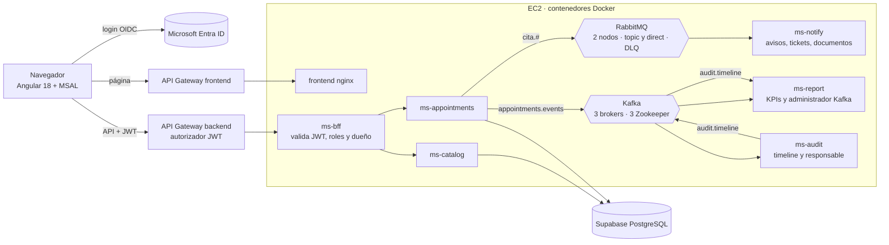

# Arquitectura general de VidaSalud

Vista única de los componentes y la comunicación entre ellos. Para el detalle de cada mensajería ver [mensajeria-rabbitmq.md](mensajeria-rabbitmq.md) y [mensajeria-kafka.md](mensajeria-kafka.md).

## Lectura del diagrama

- El navegador solo habla con API Gateway; el token lo valida el gateway y después el BFF, appointments, catalog, report y audit.
- Las tareas que no necesitan respuesta inmediata (avisos, tickets, comprobantes) van por RabbitMQ.
- Los eventos de cada cita y la auditoría van por Kafka: `appointments.events` y `audit.timeline`.
