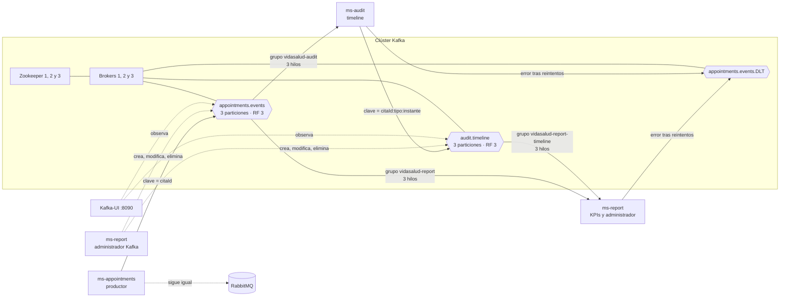
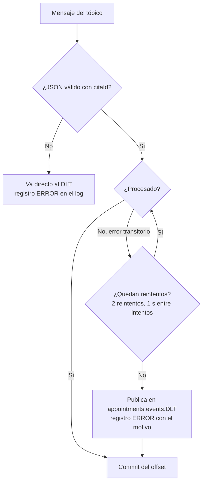

# Streaming con Kafka — VidaSalud

## Objetivo

Llevar a un flujo de eventos continuo los cambios de cada cita para que dos servicios reaccionen en tiempo real sin consultar a `ms-appointments`:

- **ms-audit** construye el *timeline* de auditoría de cada cita (quién cambió qué y cuándo, con su origen en el tópico).
- **ms-report** calcula los KPIs (citas por estado, tasa de cancelación, servicios más demandados).

RabbitMQ no cambia: sigue entregando notificaciones, tickets y comprobantes. Kafka se suma como segundo destino del mismo evento. Si Kafka no responde, la cita se guarda igual y el error queda en el log.

## Arquitectura



## Tópicos

| Tópico | Particiones | Réplicas | Retención | Cleanup | Quién lo usa | Para qué |
|---|---|---|---|---|---|---|
| `appointments.events` | 3 | 3 | 7 días (`retention.ms=604800000`) | `delete` | Productor: ms-appointments · Consumidores: ms-report y ms-audit | Un evento por cada cambio de estado de una cita |
| `audit.timeline` | 3 | 3 | 14 días (`retention.ms=1209600000`) | `compact,delete` | Productor: ms-audit · Consumidor: ms-report | Historial de cada cambio (quién/qué/cuándo/desde dónde). Clave `citaId:tipo:instante`, así la compactación solo quita repeticiones del mismo evento |
| `appointments.events.DLT` | 3 | 3 | 7 días | `delete` | Escriben los consumidores · Lee el equipo | Mensajes que no se pudieron procesar, con el motivo en las cabeceras |

Los tópicos de negocio (`appointments.events` y `audit.timeline`) tienen 3 particiones y 3 réplicas, y cada uno tiene productor y consumidor, tal como pide la rúbrica.

Parámetros comunes del clúster (`vidasalud-infra/docker-compose.kafka.yml`): `min.insync.replicas=2`, `auto.create.topics.enable=false` (los tópicos se crean explícitamente) y `default.replication.factor=3`.

## Justificación del diseño

**Tres particiones.** Cada grupo de consumidores tiene tres hilos (uno por partición), así que los eventos de todas las citas se procesan en paralelo. Con menos particiones, un hilo quedaría ocioso; con más, habría más sobrecarga de archivos y de coordinación sin ganancia en esta carga.

**Clave = id de la cita.** Kafka envía todos los mensajes con la misma clave a la misma partición. Por eso los cambios de una cita (creada → confirmada → cerrada) llegan en orden, y el timeline no puede mostrar un cierre antes de la confirmación.

**Tres réplicas y `acks=all`.** El productor espera a que el líder y las réplicas sincronizadas tengan el evento antes de confirmar. Con `min.insync.replicas=2`, una escritura necesita al menos dos copias vivas. Si cae un broker, no se pierde ningún evento confirmado y el clúster sigue aceptando escrituras. Con dos brokers caídos el clúster rechaza escrituras en lugar de aceptar datos que podrían perderse.

**Tres Zookeeper.** Forman un quórum de tres: toleran la caída de uno y mantienen la coordinación del clúster.

**Retención de 7 días.** Los KPIs y el timeline se reconstruyen desde el tópico si un servicio estuvo caído hasta una semana. Pasado ese plazo, Kafka borra los segmentos antiguos (`cleanup.policy=delete`).

**Grupos de consumidores separados.** `vidasalud-report` y `vidasalud-audit` tienen cada uno su propio desplazamiento (*offset*), así que ambos reciben todos los eventos sin interferir. Dentro de un mismo grupo, los hilos de cada instancia reparten las particiones; si una instancia cae, las demás toman sus particiones tras un reequilibrio.

**Reconstrucción al arrancar.** Como el estado de los consumidores vive en memoria, cada partición se rebobina al inicio de la retención la primera vez que se asigna al arrancar. Los rebalanceos posteriores no rebobinan: continúan desde el offset confirmado.

**Formato de fechas.** Los productores usan el `ObjectMapper` de Spring con `WRITE_DATES_AS_TIMESTAMPS` deshabilitado: las fechas viajan como ISO-8601 y no como números.

**Idempotencia.** El productor usa `enable.idempotence=true`, así un reintento de red no duplica eventos en el tópico. Los consumidores también toleran duplicados: ms-report guarda el último estado de cada cita y ms-audit descarta entradas con el mismo tipo y la misma marca de tiempo.

## Formato del evento

Clave: `citaId` (texto). Valor (JSON):

```json
{
  "tipo": "CONFIRMADA",
  "citaId": 101,
  "pacienteNombre": "Ana Pérez",
  "pacienteCorreo": "ana@ejemplo.cl",
  "servicioId": 1,
  "boxId": 2,
  "estado": "CONFIRMADA",
  "fechaHora": "2026-10-20T10:30:00",
  "ocurridoEn": "2026-11-08T14:04:09.596Z"
}
```

Los datos personales (`pacienteNombre`, `pacienteCorreo`) viajan en el tópico porque el productor usa el mismo evento para RabbitMQ. Ni `ms-report` ni `ms-audit` los guardan: sus DTO solo declaran los campos que necesitan y el resto se ignora. `ocurridoEn` es el instante en que cambió la cita y ordena el timeline. Si el tópico debiera dejar de transportar datos personales, habría que publicar un evento sin ellos para Kafka.

## Manejo de errores



- Un JSON malformado o un evento sin `citaId` no detiene el consumidor: se envía al DLT.
- Un error transitorio (por ejemplo, la base de datos ocupada) se reintenta dos veces antes de enviarlo al DLT.
- Cada envío al DLT queda en el log del consumidor con el tópico, la partición, el offset y el motivo.

Como cada grupo es independiente, un mensaje inválido llega al DLT una vez por cada grupo que lo rechazó. El equipo puede distinguir el origen por el log del servicio.

## Administración de Kafka (microservicio administrador)

Vive en `ms-report` (`/api/kafka`, solo rol Admin). Usa el `AdminClient` de Kafka y traduce los errores a códigos HTTP.

| Método | Ruta | Acción | Respuesta |
|---|---|---|---|
| GET | `/api/kafka/topics` | Lista los tópicos | 200 |
| POST | `/api/kafka/topics` | Crea un tópico con particiones, réplicas y configuración | 201 · 409 si existe · 400 si los datos son inválidos |
| GET | `/api/kafka/topics/{nombre}` | Particiones, réplicas y configuración modificada | 200 · 404 |
| PATCH | `/api/kafka/topics/{nombre}/configuracion` | Cambia parámetros, por ejemplo `retention.ms` o `cleanup.policy` | 200 |
| POST | `/api/kafka/topics/{nombre}/particiones` | Aumenta el número de particiones (no se puede reducir) | 200 · 400 |
| DELETE | `/api/kafka/topics/{nombre}` | Elimina el tópico | 204 · 404 |
| GET | `/api/kafka/consumer-groups` | Lista los grupos y su estado (STABLE, EMPTY, ...) | 200 |
| GET | `/api/kafka/consumer-groups/{grupo}/lag` | Offset consumido, offset final y lag por partición | 200 |

Ejemplo para crear el tópico de citas:

```bash
curl -X POST http://localhost:8084/api/kafka/topics \
  -H "Authorization: Bearer $TOKEN" -H "Content-Type: application/json" \
  -d '{"nombre":"appointments.events","particiones":3,"replicas":3,
       "configuracion":{"retention.ms":"604800000","cleanup.policy":"delete","min.insync.replicas":"2"}}'
```

El lag es la métrica que indica si un servicio va atrasado: si crece de forma sostenida, el consumidor no alcanza al ritmo de las citas.

## Levantar el clúster

```bash
cd vidasalud-infra
docker compose -f docker-compose.kafka.yml up -d        # 3 Zookeeper, 3 brokers y Kafka-UI
docker compose -f docker-compose.yml -f docker-compose.kafka.yml --profile apps up -d --build
```

Kafka-UI queda en `http://localhost:8090`.

## Guion de demostración

1. `docker compose -f docker-compose.kafka.yml ps`: tres `zookeeper` y tres `kafka` en estado *healthy*.
2. En Kafka-UI (`:8090`), *Topics*: `appointments.events` y `appointments.events.DLT`, cada uno con 3 particiones y replication factor 3. Explicar por qué (ver *Justificación del diseño*).
3. En Kafka-UI, *Brokers*: los tres brokers vivos y el controlador. Explicar cómo se administran brokers, tópicos, particiones y mensajes desde ahí.
4. Agendar una cita en el frontend. Al cabo de unos segundos, `GET /api/report/kpis` cambia el total, y `GET /api/audit/citas/{id}/timeline` muestra cada cambio con su partición y offset.
5. `GET /api/kafka/consumer-groups/vidasalud-report/lag`: lag cercano a cero. Mostrar en Kafka-UI, *Consumers*, la distribución de particiones entre los hilos.
6. Detener un broker (`docker stop kafka2`): el tópico sigue con líder y las escrituras se mantienen porque quedan dos réplicas sincronizadas. Volverlo a levantar (`docker start kafka2`).
7. Enviar un mensaje malformado al tópico y mostrar que aparece en `appointments.events.DLT` mientras el consumidor sigue procesando.

## Limitaciones conocidas

- La prueba de extremo a extremo con ms-appointments depende de la base de datos Supabase; si el proyecto está pausado, la cita no se crea y no se publican eventos.
- Las entradas de `audit.timeline` que ms-audit publicó antes del cambio a fecha ISO-8601 conservan el formato numérico. Comparten clave con las nuevas, así que la compactación las reemplaza.
- ms-report y ms-audit guardan sus datos en memoria. Al arrancar releen cada partición desde el inicio de la retención (7 días) para reconstruirlos. Por eso, el historial de más de 7 días se pierde al reiniciar, y el arranque tarda más cuanto más eventos haya en el tópico.
- Cada reinicio vuelve a leer los mensajes inválidos que siguen en el tópico y los envía otra vez al DLT, así que el DLT crece con los reinicios. Con persistencia de estado (base de datos) bastaría con un offset confirmado, sin repetir el replay.
- Tres brokers, tres Zookeeper y Kafka-UI requieren más memoria de la que tiene una EC2 t3.small. Para la demostración en la nube conviene una instancia más grande o reducir los límites de memoria de los contenedores.
