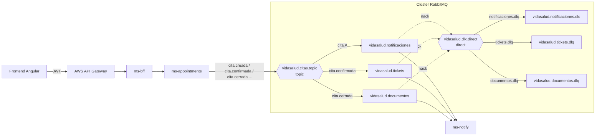
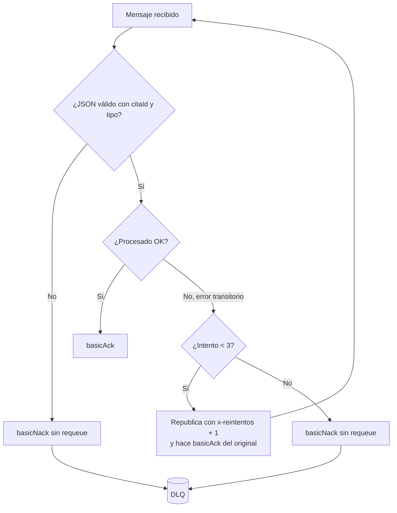

# Mensajería con RabbitMQ — VidaSalud

## Objetivo

Sacar del flujo HTTP las tareas que no necesitan respuesta inmediata: avisar al paciente, emitir el ticket de atención y generar el comprobante. `ms-appointments` publica un evento y sigue respondiendo; `ms-notify` lo procesa por su cuenta. Si RabbitMQ no está disponible, la cita se guarda igual.

## Arquitectura



El clúster tiene dos nodos (`rabbitmq1` y `rabbitmq2`) que se levantan con `docker-compose` desde el repo `vidasalud-infra`.

## Casos de uso

| Caso de uso | Disparador | Routing key | Cola | DLQ | Resultado |
|---|---|---|---|---|---|
| Notificar al paciente | Cualquier cambio de la cita | `cita.#` | `vidasalud.notificaciones` | `vidasalud.notificaciones.dlq` | Correo (simulado) con el nuevo estado |
| Emitir ticket de atención | Cita confirmada | `cita.confirmada` | `vidasalud.tickets` | `vidasalud.tickets.dlq` | Número correlativo `T-0001` |
| Generar comprobante | Cita cerrada | `cita.cerrada` | `vidasalud.documentos` | `vidasalud.documentos.dlq` | Comprobante `DOC-AAAAMMDD-<id>` |

## Formato del evento

```json
{
  "tipo": "CONFIRMADA",
  "citaId": 101,
  "pacienteNombre": "Ana Pérez",
  "servicioId": 1,
  "boxId": 2,
  "estado": "CONFIRMADA",
  "fechaHora": "2026-10-20T10:30:00",
  "ocurridoEn": "2026-10-17T19:04:09.596Z"
}
```

## Manejo de errores



Cada consumidor (`NotificacionCitaListener`, `TicketCitaListener` y `DocumentoCitaListener`) ejecuta explícitamente `basicAck` o `basicNack`. La decisión de reintentar o mandar a la DLQ la toma `ConfirmacionMensajes.reintentarOEnviarADlq`. Cada envío a una DLQ se registra en el log de `ms-notify` con nivel `ERROR` y el motivo.

## Configuración centralizada

| Servicio | Dónde están los nombres | Dónde se declaran los beans |
|---|---|---|
| ms-notify | `application.yml` → `vidasalud.mensajeria` (exchanges, colas, DLQ, patrones y reintentos) | `RabbitTopologyConfig` (Queue, Exchange y Binding por caso de uso), `RabbitListenerConfig` (ACK manual) y `OpenApiConfig` (Swagger) |
| ms-appointments | `application.yml` → `vidasalud.mensajeria` (exchanges y routing key de cada evento) | `RabbitConfig` (exchange topic, conversor JSON y confirmaciones del broker) |

## Guion de demostración

1. `docker exec rabbitmq1 rabbitmqctl cluster_status` muestra los dos nodos en *Running Nodes*.
2. En el panel `:15672`, pestaña *Exchanges*: `vidasalud.citas.topic` (topic) y `vidasalud.dlx.direct` (direct).
3. Pestaña *Queues*: las 3 colas con sus 3 DLQ.
4. En el frontend, agenda una cita, confírmala y ciérrala. Luego `GET /api/notify/tickets` y `GET /api/notify/documentos` muestran el ticket y el comprobante.
5. Envía un mensaje inválido con `POST /api/rabbit/messages` y verás el contador de la DLQ subir.
6. Crea y elimina una cola, un exchange y un binding con `/api/rabbit/...`, y muestra el error 400 al enviar un nombre vacío.
